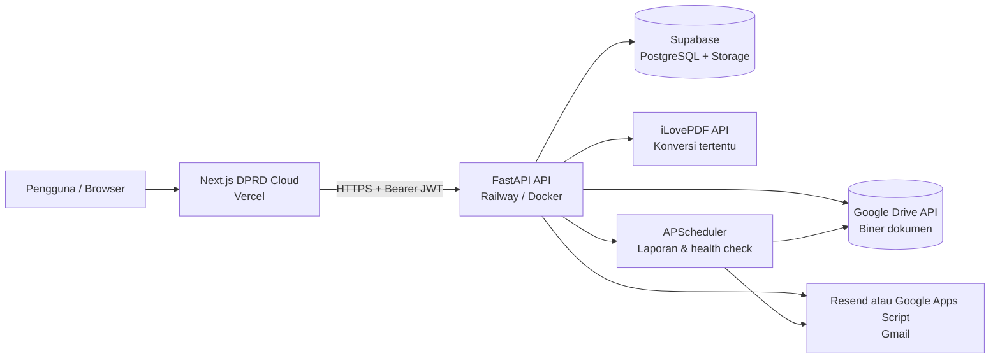
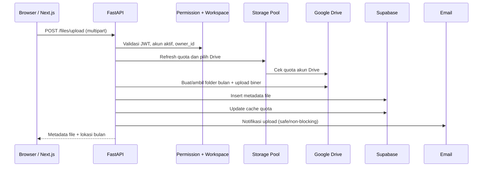
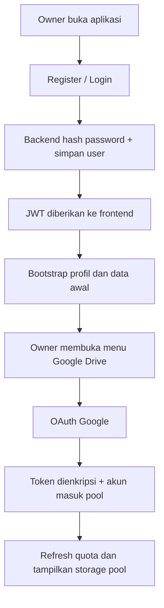
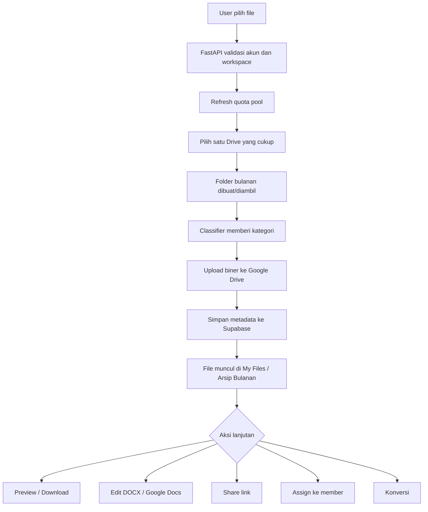
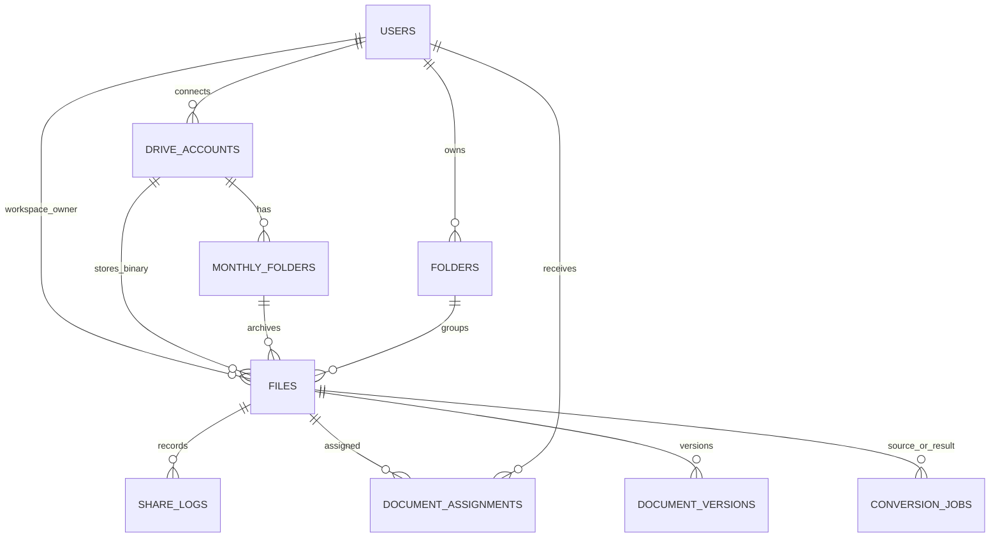

# Laporan Analisis Sistem Yudit Cloud / DPRD Cloud

**Jenis dokumen:** Analisis arsitektur, fungsional, alur bisnis, integrasi, keamanan, dan kesiapan operasional  
**Tanggal analisis:** 4 November 2026  
**Sumber utama:** `universal_project_analysis(6).txt` (frontend `kp-frnt`) dan `universal_project_analysis(7).txt` (backend `cloud-projek`)  
**Status:** Audit statis atas snapshot kode dan dokumentasi yang diberikan; bukan hasil penetration test atau pengujian langsung layanan produksi.

---

## 1. Ringkasan eksekutif

Yudit Cloud / DPRD Cloud adalah aplikasi pengelolaan dokumen berbasis workspace. Konsep utamanya adalah menyatukan beberapa akun Google Drive ke dalam sebuah **virtual storage pool** yang dilihat pengguna sebagai satu ruang kerja. Aplikasi menyimpan file biner pada Google Drive yang terhubung, sedangkan Supabase/PostgreSQL berperan sebagai pusat metadata, identitas, relasi workspace, hak akses, penugasan, status berbagi, dan informasi pekerjaan.

Frontend Next.js menyediakan antarmuka untuk autentikasi, daftar dokumen, arsip bulanan, statistik, koneksi Drive, kolaborator, dokumen yang ditugaskan, pratinjau, editor DOCX/Google Docs, sharing, dan konversi. Backend FastAPI menjadi pusat orkestrasi dan penegakan aturan bisnis. Railway menjalankan backend container dan Vercel menjalankan frontend.

**Cara paling tepat memahami produk ini:** bukan “Google Drive baru” dan bukan pula penyimpanan biner yang seluruhnya berada di Supabase. Produk ini adalah **lapisan manajemen dokumen dan akses di atas sejumlah Google Drive**. Metadata disatukan agar pengalaman pengguna terasa seperti satu filesystem virtual, tetapi data file tetap tersebar pada akun-akun Drive sumbernya.

### 1.1 Temuan utama

| Area | Kesimpulan | Status bukti |
|---|---|---|
| Identitas produk | UI memakai nama DPRD Cloud; README backend memakai nama Yudit Cloud | Terlihat di kode/dokumentasi |
| Arsitektur inti | Next.js + FastAPI + Supabase + Google Drive API | Terlihat di konfigurasi, dependency, router, dan service |
| Penyatuan penyimpanan | Pool menggabungkan quota beberapa Drive dan memilih satu Drive untuk setiap upload | Terlihat di service |
| Multi-role | `owner`, `super_admin`, `member`; data dokumen dimiliki workspace owner | Terlihat di permission service dan router |
| Arsip | Folder bulanan `NamaBulan-YYYY` dibuat per akun Drive | Terlihat di service |
| Sharing | Link publik dengan token, expiry opsional, password opsional | Terlihat di router |
| Assignment | Dokumen dapat ditugaskan ke member dengan flag edit/delete/share dan expiry | Terlihat di router |
| Email | Notifikasi via Resend atau Google Apps Script/Gmail, dengan scheduler | Terlihat di service/config |
| AI/ML/Kafka | Analyzer mendeteksi kata kunci, tetapi modul/agent/model/streaming tidak ditemukan | Tidak terbukti; jangan dipromosikan sebagai fitur aktif |
| Kesiapan database | SQL yang disertakan belum mencakup semua tabel/kolom yang direferensikan kode | Gap dokumentasi/migrasi yang perlu diselesaikan |

### 1.2 Prioritas perbaikan

1. **P0 - Perbaiki otorisasi assignment.** `expires_at` belum konsisten membatasi akses baca dan hapus; `can_share` tersimpan tetapi belum diperiksa saat membuat share link.
2. **P0 - Lengkapi dan versioning schema database.** Kode menggunakan tabel/kolom yang tidak ada pada `sql/schema.sql` yang disertakan.
3. **P1 - Perbaiki transaksi lintas layanan.** Upload Google Drive lalu insert metadata Supabase dapat meninggalkan file yatim apabila tahap kedua gagal.
4. **P1 - Tegaskan strategi email fallback.** Saat kredensial Resend tersedia, kegagalan Resend tidak otomatis mencoba GAS.
5. **P1 - Konsolidasikan konfigurasi deployment dan scheduler.** Samakan lockfile/package manager, healthcheck port, dan pastikan scheduler hanya berjalan satu kali lintas replica.
6. **P1 - Perkuat OAuth state dan pengelolaan secret.** Tambahkan expiry/nonce dan pisahkan key JWT dari key enkripsi token Drive.
7. **P2 - Selaraskan pengalaman upload role member.** Topbar dapat menghalangi upload sementara Dropzone/API menerima upload.

---

## 2. Ruang lingkup dan cara membaca hasil

Audit ini membaca dua export analyzer, bukan repositori Git secara langsung. Export berisi file yang dipilih oleh `write.py`; beberapa direktori sengaja dikecualikan. Oleh karena itu:

- Temuan “terlihat” berarti ada kode/config yang mendukung pernyataan tersebut.
- “Didokumentasikan” berarti tercantum pada README atau komentar, tetapi tidak otomatis membuktikan perilaku runtime.
- “Inferensi” berarti gambaran alur disusun dari hubungan antar modul.
- “Belum terbukti” berarti analyzer tidak menemukan implementasi yang dapat menguatkan klaim.
- Pengujian live terhadap Railway, Vercel, Supabase, Google OAuth Console, DNS email, dan akun Google Drive tidak dilakukan.

### 2.1 Input yang dianalisis

| Artefak | Proyek | Isi yang dominan |
|---|---|---|
| `universal_project_analysis(6).txt` | `kp-frnt` | Next.js, React, Zustand, UI, API client, views, modal, editor, `vercel.json` |
| `universal_project_analysis(7).txt` | `cloud-projek` | FastAPI, router, service, config, Dockerfile, requirements, SQL schema, README backend |

### 2.2 Keterbatasan analyzer

`write.py` mendeteksi arsitektur melalui pencarian substring/pola sederhana. Hasil “DETECTED ARCHITECTURE” bukan bukti bahwa komponen benar-benar diimplementasikan atau aktif. Contohnya, Kafka, ML Model, AI Agents, HuggingFace, dan Prisma terdeteksi sebagai kata/pola, tetapi laporan struktur modul menyatakan `AGENTS None`, `ML_MODELS None`, `STREAMING None`, dan `PROVIDERS None`. Tidak ada bukti pipeline Kafka, model inference, agent orchestrator, atau layanan HuggingFace yang aktif dalam snapshot ini.

---

## 3. Tujuan produk dan model mental sistem

### 3.1 Masalah yang hendak diselesaikan

Sistem tampaknya ditujukan untuk organisasi/workspace yang perlu:

- Mengelola dokumen dari beberapa akun Google Drive tanpa meminta pengguna berpindah akun setiap saat.
- Menyimpan metadata dan katalog file secara terpusat.
- Mengelompokkan dokumen otomatis menurut bulan dan kategori administrasi.
- Mengatur akses berdasarkan peran serta penugasan dokumen.
- Menyediakan tautan berbagi yang dapat diberi password dan masa berlaku.
- Mengubah, melihat, dan mengedit dokumen melalui satu antarmuka.
- Memantau kapasitas gabungan, aktivitas dokumen, dan pekerjaan konversi.
- Mengirim undangan dan pemberitahuan melalui email.

### 3.2 Batas konsep penyimpanan virtual

Istilah “unlimited Google Drive” di README harus dipahami sebagai **kapasitas agregat dari akun Drive yang berhasil dihubungkan**, bukan kapasitas tanpa batas secara literal.

- Sistem menghitung total/terpakai dari akun Drive aktif.
- Saat upload, satu file ditempatkan ke satu akun Drive yang memiliki ruang cukup.
- Kode pemilih Drive tidak membagi satu file menjadi beberapa potongan lintas akun.
- Setiap file tetap terikat kepada `drive_account_id` dan `remote_file_id` tertentu.
- Ketersediaan layanan bergantung pada quota per akun, limit API Google, token OAuth, dan `MAX_DRIVE_ACCOUNTS` bila dikonfigurasi.

### 3.3 Pemisahan data

| Jenis data | Lokasi utama | Keterangan |
|---|---|---|
| Biner file asli | Google Drive | File disimpan di akun Drive yang terpilih |
| Metadata file | Supabase/PostgreSQL | Nama, MIME, ukuran, folder, kategori, Drive, tanggal, share state, dan relasi |
| Identitas aplikasi | Supabase/PostgreSQL | User, role, owner workspace, status akun |
| Token OAuth Drive | Supabase (terenkripsi aplikasi) | Access/refresh token dienkripsi melalui Fernet |
| Gambar yang diunggah dari editor | Supabase Storage bucket `doc-images` | Endpoint memperoleh public URL |
| Data job/assignment/version/audit/email | Supabase/PostgreSQL | Direferensikan kode, tetapi sebagian tabel belum ada pada SQL yang diekspor |

---

## 4. Arsitektur tingkat tinggi



### 4.1 Peran tiap lapisan

| Lapisan | Teknologi | Tanggung jawab |
|---|---|---|
| Presentation | Next.js 16 / React 19 | Halaman, navigasi role, modal, editor, preview, status job |
| State/UI | Zustand, Axios, Tailwind, Radix/shadcn-style UI, Framer Motion | State sesi dan data, interaksi, request API, layout |
| API/orchestration | FastAPI | Autentikasi request, validasi, permission, integrasi eksternal, streaming |
| Metadata | Supabase/PostgreSQL | User, workspace, daftar file, folder, share, assignment, job, audit |
| File storage | Google Drive API | Upload, download, preview, folder bulanan, quota |
| Document processing | python-docx, Mammoth, pdf2docx, PyMuPDF, pdfplumber, OpenCV headless | Pengolahan dokumen lokal tertentu |
| External conversion | iLovePDF | Operasi PDF/office tertentu sesuai kredensial/kuota provider |
| Email | Resend / GAS-Gmail | Undangan, notifikasi, ringkasan, alert |
| Runtime | Railway + Docker; Vercel | Menjalankan API dan frontend |

### 4.2 Arah komunikasi

1. Browser memuat aplikasi Next.js dari Vercel.
2. Frontend membangun request ke FastAPI menggunakan API client dan header `Authorization: Bearer <token>`.
3. FastAPI memvalidasi JWT dan mengambil profil pengguna dari tabel `users`.
4. Router memeriksa akses workspace dan file melalui `permission_service`.
5. Service membaca/menulis metadata ke Supabase dan berkomunikasi dengan Google Drive atau provider lain.
6. Backend mengembalikan metadata atau streaming file kepada browser.

### 4.3 Deployment yang terlihat

| Komponen | Platform | Bukti konfigurasi | Catatan |
|---|---|---|---|
| Frontend | Vercel | `vercel.json`, framework Next.js, region `sin1` | Rewrite `/api/backend/:path*` diarahkan ke Railway |
| Backend | Railway | README backend, Dockerfile, komentar `PORT` Railway | Uvicorn listen ke `0.0.0.0:${PORT:-8000}` |
| Database | Supabase | `SUPABASE_URL`, `SUPABASE_SERVICE_KEY`, client creation | PostgreSQL dan Supabase Storage |
| File | Google Drive | Google OAuth + Drive API dependencies | Biner file di akun pengguna/workspace |
| Konversi | iLovePDF | `ILOVEPDF_*` config dan client | Ada batas ukuran default 100 MB di config |
| Email | Resend atau GAS | `RESEND_API_KEY`, `GAS_WEBHOOK_URL`, `GAS_API_SECRET` | Provider dipilih berdasarkan konfigurasi |

**Konfigurasi frontend yang perlu diselaraskan:** `vercel.json` menampilkan rewrite Railway, sementara API client menggunakan `NEXT_PUBLIC_API_URL`. Pastikan satu jalur canonical dipakai konsisten agar URL API tidak berbeda antara local, preview, dan production.

---

## 5. Aktor, role, dan batas workspace

### 5.1 Model role

| Role | Makna | Hak inti yang terlihat |
|---|---|---|
| `owner` | Pemilik workspace | Mengelola workspace, Drive, collaborator, dokumen, kategori, assignment, dan konfigurasi terkait |
| `super_admin` | Pengelola workspace yang diberi kewenangan tinggi | Dapat mengelola workspace dan data workspace; beberapa aksi tetap owner-only |
| `member` | Collaborator/pelaksana tugas | Melihat dan mengerjakan dokumen yang ditugaskan; tidak mengelola pool Drive atau daftar collaborator |

`resolve_owner_id()` mengembalikan ID pemilik workspace untuk owner maupun collaborator. File disimpan dengan `files.user_id = owner_id`; kolom `uploaded_by` merekam siapa yang mengunggah. Jadi kepemilikan file secara data adalah milik workspace, bukan akun member yang mengunggah.

### 5.2 Matriks hak akses ringkas

| Aktivitas | Owner | Super Admin | Member |
|---|---:|---:|---:|
| Login dan ganti password | Ya | Ya | Ya |
| Melihat file workspace | Ya | Ya | Hanya file yang di-assign |
| Upload ke pool workspace | Ya | Ya | Backend mengizinkan akun aktif; kebijakan produk perlu ditegaskan |
| Connect/disconnect Drive | Ya | Ya | Tidak |
| Melihat storage pool | Ya | Ya | Tidak melalui halaman Drive |
| Kelola collaborator | Ya | Ya | Tidak |
| Assign dokumen | Ya | Ya | Tidak |
| Mengedit dokumen | Ya | Ya | Jika `can_edit` dan assignment belum expired |
| Menghapus dokumen | Ya | Ya | Jika `can_delete`; expiry belum ditegakkan di fungsi backend |
| Membuat share link | Ya | Ya | Akses assignment cukup menurut pemeriksaan saat ini; `can_share` belum ditegakkan |
| Kelola kategori workspace | Ya | Ya | Tidak untuk perubahan yang mensyaratkan manager |
| Mengakses Dokumen Saya | Tidak sebagai menu khusus | Tidak sebagai menu khusus | Ya |

> Catatan: matriks ini menggambarkan pola yang tampak pada kode. Uji end-to-end per endpoint tetap diperlukan, terutama untuk operasi yang melibatkan `can_share`, expiry, bulk actions, dan upload member.

### 5.3 Temuan UX terkait member upload

- `fetchDrives()` pada frontend tidak mengambil daftar Drive untuk role non-manager, sehingga state Drive member kosong.
- Tombol upload di Topbar memeriksa `drives.length === 0` dan dapat mengarahkan member untuk menghubungkan Drive.
- Dropzone pada halaman file memanggil aksi upload secara langsung; backend `require_can_upload()` hanya memeriksa akun aktif, bukan role manager.
- Hasilnya, jalur upload dapat berbeda tergantung kontrol UI yang digunakan.

**Keputusan produk yang disarankan:** putuskan apakah member memang boleh upload. Bila boleh, perbaiki Topbar agar tidak mengunci upload karena daftar Drive memang sengaja disembunyikan. Bila tidak boleh, terapkan larangan di backend `require_can_upload()` dan seluruh kontrol UI.

---

## 6. Modul dan fitur sistem

### 6.1 Autentikasi

- Registrasi owner dan login melalui FastAPI.
- Password disimpan sebagai hash bcrypt (bukan teks asli).
- JWT ditandatangani HS256 dan memiliki expiration; default `ACCESS_TOKEN_EXPIRE_MINUTES=1440` atau 24 jam.
- `get_current_user` decode token, mengambil user dari Supabase, dan memblokir user nonaktif.
- Terdapat alur forced password change untuk akun baru/undangan.

**Catatan:** API client frontend menyimpan token pada `localStorage` (`yudit_token`). Pola ini rentan terhadap pencurian token bila terjadi XSS. Pertimbangkan HttpOnly Secure SameSite cookie/BFF, CSP ketat, sanitasi HTML editor, token lebih pendek, dan mekanisme refresh/revoke.

### 6.2 Google Drive OAuth dan manajemen akun

Alur yang ditemukan:

1. Owner/super_admin membuka menu Google Drive dan meminta URL OAuth.
2. Backend membatasi endpoint connect untuk owner/super_admin.
3. Backend membentuk state JWT dan auth URL Google dengan akses offline serta prompt consent.
4. Pengguna memberikan izin ke Google.
5. Google mengirim `code` dan `state` ke callback FastAPI.
6. Backend memverifikasi state, memetakan actor ke owner workspace, memeriksa limit akun, menukar code, lalu mengambil email profil Google.
7. Access token dan refresh token dienkripsi sebelum disimpan.
8. Akun Drive ditambahkan ke pool, quota diperbarui, notifikasi dikirim, dan frontend diarahkan ke halaman Drive.
9. Jika akun Google yang sama pernah di-soft-delete, callback memiliki jalur resurrection dan file tersembunyi dibuka kembali.

**Risiko OAuth:** state yang terlihat berisi `sub` dan tanda tangan, tetapi payload state yang dibangun tidak memperlihatkan expiry/nonce khusus. Tambahkan state one-time dengan TTL singkat dan nonce terikat ke sesi. Pisahkan secret untuk JWT dan enkripsi token agar rotasi dapat dikelola dengan versi key.

### 6.3 Storage Pool dan pemilihan Drive

- `refresh_all_quotas()` mengambil Drive aktif dan memperbarui quota bila cache sudah kedaluwarsa.
- TTL default `QUOTA_CACHE_TTL_SECONDS=300` detik.
- `get_pool_summary()` menghitung total, used, free, dan jumlah account dari Drive aktif.
- `pick_drive_for_upload()` memilih akun yang memiliki ruang individu cukup untuk file tersebut.
- Strategi pemilihan yang terlihat menyerupai best-fit: pilih ruang cukup yang paling kecil agar ruang di Drive lebih besar tetap tersedia untuk file berikutnya.

Konsekuensi: kapasitas gabungan ditampilkan sebagai pool, tetapi satu file tidak boleh lebih besar daripada ruang kosong di salah satu Drive yang eligible. Jika total pool 100 GB namun tersisa 20 GB dan 80 GB di dua akun secara terpisah, satu file 30 GB belum tentu bisa ditaruh jika tidak ada akun individual dengan ruang 30 GB.

### 6.4 Upload dokumen



Rincian proses `process_upload()`:

1. Simpan file upload sementara di direktori temp server.
2. Tentukan `owner_id` workspace serta `user_id` actor/uploader.
3. Refresh quota Drive milik owner.
4. Pilih Drive yang memiliki ruang cukup.
5. Pastikan folder bulanan sudah tersedia pada Drive terpilih.
6. Klasifikasikan dokumen berdasarkan nama/MIME/ekstensi.
7. Upload file biner ke Google Drive.
8. Insert metadata ke tabel `files`, termasuk `user_id`, `uploaded_by`, `drive_account_id`, `remote_file_id`, nama, ukuran, kategori, tanggal, dan folder.
9. Perbarui cache quota dan bersihkan file temp.
10. Kirim notifikasi upload kepada admin workspace.

**Catatan konsistensi:** operasi Google Drive dan Supabase tidak berada dalam satu transaksi database. Bila upload ke Drive berhasil tetapi insert metadata gagal, file biner bisa tertinggal tanpa metadata. Terapkan pola saga/compensation (hapus remote file saat insert gagal), idempotency key, dan job rekonsiliasi.

### 6.5 Arsip otomatis bulanan

- Nama folder menggunakan format seperti `November-2026`.
- Tabel `monthly_folders` menyimpan mapping folder lokal dengan folder ID remote Google Drive.
- Unique constraint yang ditampilkan adalah per `drive_account_id` dan `folder_name`.
- Karena folder dibuat pada Drive terpilih, satu periode dapat memiliki folder bulanan pada beberapa akun Drive.

**Perlu penyelarasan waktu:** upload mengisi tanggal menggunakan `datetime.now(timezone.utc)` sedangkan scheduler memakai `Asia/Jakarta`. Tetapkan satu timezone bisnis untuk penamaan bulan/tanggal agar upload dekat pergantian hari/bulan tidak masuk periode yang berbeda dari yang dilihat pengguna.

### 6.6 Klasifikasi otomatis dan kategori

Classifier yang terlihat menggunakan pola nama file, tipe MIME, serta ekstensi. Kategori administrasi yang muncul mencakup antara lain Surat Masuk, Surat Keluar, BA, SK Pimpinan, SK DPRD, Surat Persetujuan Bersama, SPJ, dan Notulen; kategori generik meliputi Dokumen, Gambar, Video, Audio, Arsip, Spreadsheet, Presentasi, Kode, dan Lainnya.

- Kode `classify(filename, mime_type)` menerima nama dan MIME; tidak tampak melakukan pembacaan semantik isi dokumen.
- Karena itu label “AI auto classification” belum didukung bukti. Istilah yang lebih akurat: **rule-based filename/MIME classifier**.
- `category_confidence` disimpan sehingga UI dapat memberi konteks bahwa klasifikasi adalah perkiraan.
- Kategori khusus dapat dikelola melalui router categories.

Rekomendasi: dukung override manual, simpan alasan/rule yang cocok, tambahkan evaluasi akurasi, dan jangan gunakan klasifikasi otomatis untuk menentukan akses/retensi tanpa verifikasi manusia.

### 6.7 Pencarian, filter, arsip, dan statistik

Daftar file menyediakan filter folder, kategori, nama, tahun, bulan, hari, rentang tanggal, tipe file, dan sorting. Backend memiliki endpoint daftar, kategori, statistik, folder bulanan, reclassify, bulk delete, dan bulk category. UI menampilkan menu `My Files`, `Per Bulan`, dan `Statistik`.

Statistik mengagregasi jumlah/ukuran dokumen dan distribusi berdasarkan periode, tipe, serta kategori. Frontend menggunakan Recharts untuk visualisasi.

### 6.8 Folder workspace

Folder biasa merupakan pengelompokan logis melalui metadata `folder_id` pada tabel `files`. Sementara folder bulanan merupakan folder fisik di Google Drive yang dipetakan di `monthly_folders`. Kedua konsep tersebut jangan dianggap sama.

Pada alur upload, biner diletakkan ke folder bulanan di Google Drive, sedangkan `folder_id` menyimpan relasi folder workspace. Pastikan UI dan dokumentasi menjelaskan apakah folder workspace hanya virtual atau benar-benar mencerminkan struktur fisik Drive.

### 6.9 Preview dan download

Backend memuat metadata, memastikan file dapat diakses, mengambil referensi Drive account dan `remote_file_id`, lalu mengalirkan biner dari Google Drive sebagai `StreamingResponse`. Preview memakai `Content-Disposition: inline`; download memakai `attachment`; cache-control dibedakan.

Format yang didokumentasikan meliputi PDF, gambar, video, audio, dan teks. Dukungan aktual bergantung pada MIME browser dan komponen preview yang dipakai.

### 6.10 Sharing publik

- Endpoint autentikasi membuat share token acak (`secrets.token_urlsafe(32)`).
- Default expiry adalah 168 jam (7 hari). Handler hanya membuat expiry jika nilai `expires_hours` truthy; payload `null`/`0` dapat melewati expiry, sehingga perilaku link tanpa expiry perlu dikendalikan secara eksplisit.
- Password opsional disimpan sebagai bcrypt hash.
- Public endpoint menyediakan info, download, dan preview.
- Download mencatat IP/user-agent ke `share_logs` dan counter view diperbarui.
- Pemilik dapat mencabut share.

Token share pada praktiknya adalah bearer secret: siapa pun yang memegang token yang valid dapat mencoba akses sesuai password/expiry. Hindari menyebarkan token melalui log analytics, referrer, atau kanal yang tidak aman. Tambahkan rate limit untuk percobaan password dan kebijakan retensi log IP.

**Temuan keamanan:** `create_share()` memeriksa `can_access_file()`, tetapi tidak memeriksa flag `can_share` pada assignment. Artinya flag `can_share=false` belum mencegah member yang punya assignment untuk membuat link. Ini harus diperbaiki di backend, bukan hanya di UI.

### 6.11 Collaborator dan undangan

- Owner/super_admin dapat melihat dan mengundang collaborator.
- Invite menerima email, username opsional, dan role.
- Password sementara dibuat acak dengan panjang default 18 karakter dan disimpan sebagai hash.
- User baru ditandai untuk forced password change.
- Email undangan dikirim; hasil provider dinormalisasi agar HTTP 200 saja tidak dianggap bukti pengiriman sukses.
- Owner dapat mengubah role/status/reset password; penghapusan collaborator dibatasi owner pada route yang terlihat.

Password sementara yang dikembalikan pada response untuk kemungkinan copy manual oleh admin perlu dijaga: tampilkan sekali, jangan log, jangan simpan ke client storage, dan audit aksesnya. Lebih aman gunakan activation link sekali pakai yang kedaluwarsa.

### 6.12 Assignment dan Dokumen Saya

Assignment mengikat file ke member dan menyimpan:

- `can_edit`
- `can_delete`
- `can_share`
- `note`
- `expires_at`
- `assigned_by` dan `assigned_to`

Owner/super_admin memvalidasi file workspace dan target member, membuat/memperbarui assignment, mencatat audit, dan mengirim notifikasi. Member melihat daftar pada endpoint `/assignments/my` dan menu Dokumen Saya.

**Ketidakkonsistenan izin yang perlu diperbaiki:**

1. `can_edit_file()` mengecek `expires_at`.
2. `can_access_file()` hanya memeriksa adanya assignment; belum mengecek expiry.
3. `can_delete_file()` memeriksa `can_delete`; belum mengecek expiry.
4. `annotate_files_for_user()` menghitung expiry untuk flag UI, sehingga UI dapat menyembunyikan aksi yang sebenarnya masih dapat dipanggil lewat API.
5. `create_share()` tidak mengecek `can_share`.

Hasilnya, expired assignment dapat tetap memberi akses baca/download/preview; jika `can_delete=true`, potensi akses hapus juga masih ada. Tutup ini sebagai prioritas P0.

### 6.13 Editor DOCX dan Google Docs

Modul dokumen menyediakan pembukaan editor, simpan, daftar versi, detail versi, restore, raw download, konversi ke Google Docs, info Google Docs, sync dari Google Docs, penghapusan Google Doc, dan upload gambar.

Alur DOCX lokal yang terlihat:

1. Backend download file DOCX dari Drive.
2. Validasi signature file ZIP/DOCX.
3. Mammoth mengubah DOCX menjadi HTML.
4. Frontend Tiptap/editor menampilkan dan mengubah konten.
5. Backend mengubah HTML ke DOCX menggunakan python-docx/BeautifulSoup.
6. Hasil diunggah kembali ke Drive dan versi disimpan melalui metadata/version store.
7. Hash konten dipakai untuk membantu deteksi perubahan/konflik.

Google Docs conversion/sync memanfaatkan Google Drive/Docs API. Gambar yang diunggah dari editor disimpan ke Supabase Storage bucket `doc-images` dan memperoleh public URL.

Batasan penting: konversi DOCX↔HTML dapat mengubah layout/fitur Word kompleks (layout kolom, section, field, numbering rumit, header/footer, objek embedded). Uji dokumen representatif sebelum menjanjikan fidelity 100%.

### 6.14 Konversi PDF dan office

Operasi yang didaftarkan antara lain:

| Operasi | Jalur yang terdeteksi | Catatan |
|---|---|---|
| Merge PDF | iLovePDF | Menggabungkan beberapa sumber |
| Split PDF | iLovePDF | Memecah PDF |
| Compress PDF | iLovePDF | Kompresi |
| JPG to PDF | iLovePDF | Gambar ke PDF |
| Word to PDF | iLovePDF | Office ke PDF |
| Scan to PDF | iLovePDF | Gambar/scan menjadi PDF |
| PDF to JPG | iLovePDF | Render halaman ke gambar |
| PDF to Word | Lokal `pdf2docx` | Jalur lokal tersedia |
| OCR PDF | iLovePDF | Diperlukan layanan/provider yang sesuai |
| PDF to Markdown | iLovePDF | Diperlukan layanan/provider yang sesuai |

Alur conversion: validasi akses dan file, buat conversion job, download sumber sementara dari Drive, jalankan proses lokal/provider, download hasil, pilih Drive untuk hasil, upload ke folder bulanan, insert metadata file turunan dengan parent/operation, update job success/failure, dan bersihkan temporary files.

`ILOVEPDF_MAX_FILE_MB` default 100 MB pada config. OCR dan PDF-to-Markdown ditandai sebagai operasi premium/provider-dependent di metadata operasi; pastikan akun iLovePDF dan entitlement benar-benar tersedia.

**Privasi:** pada operasi yang menggunakan iLovePDF, konten dokumen dikirim ke layanan pihak ketiga untuk diproses. Informasikan hal ini dalam kebijakan privasi/ketentuan organisasi dan batasi tipe dokumen sensitif yang boleh diproses jika diperlukan.

### 6.15 Email dan scheduler

Jenis notifikasi yang terlihat antara lain undangan collaborator, file diunggah, Drive terhubung, error autentikasi Drive, dokumen ditugaskan, ringkasan storage pool bulanan, ringkasan folder, welcome, dan password changed.

Provider email:

- Jika `RESEND_API_KEY` dan `RESEND_FROM` diisi, `send_email()` mencoba Resend.
- Jika konfigurasi Resend tidak tersedia, jalur GAS webhook digunakan.
- Hasil log membedakan accepted oleh provider dari penempatan inbox; `inbox_placement` dicatat `unknown`.
- Kode memiliki event ID deterministik dan retry GAS.

**Penting:** komentar/keterangan menyiratkan Resend sebagai primary dan GAS fallback, tetapi implementasi yang terlihat mengembalikan hasil setelah mencoba Resend. Kegagalan Resend tidak otomatis mencoba GAS. Jika ingin failover, tambahkan fallback eksplisit dan aturan idempotency agar tidak mengirim email ganda.

APScheduler pada lifespan FastAPI menjadwalkan:

- Laporan bulanan untuk owner/admin dan ringkasan member yang memiliki assignment.
- Pemeriksaan kesehatan token Drive harian.

Timezone scheduler default `Asia/Jakarta`. Jika Railway menjalankan lebih dari satu replica backend, setiap instance dapat menjalankan scheduler sendiri kecuali ada distributed lock atau scheduler dipisah menjadi worker tunggal.

---

## 7. Alur bisnis end-to-end

### 7.1 Onboarding owner



### 7.2 Siklus dokumen



### 7.3 Siklus penugasan member

1. Admin memilih file workspace.
2. Admin menentukan member penerima, izin edit/delete/share, catatan, dan expiry.
3. Backend memvalidasi file serta memastikan target termasuk workspace yang sama dan aktif.
4. Assignment disimpan atau diperbarui.
5. Audit event dicoba ditulis.
6. Email pemberitahuan dikirim.
7. Member melihat Dokumen Saya.
8. Member melakukan operasi sesuai permission dan masa berlaku.

Langkah 8 saat ini perlu diperbaiki karena pemeriksaan expiry belum konsisten di semua endpoint.

### 7.4 Siklus share publik

1. Pengguna yang login memilih file dan membuat share.
2. Backend menghasilkan token acak, menyimpan expiry/password hash, serta mengaktifkan status public.
3. Pengguna mengirim URL `/share/{token}`.
4. Pengunjung membuka info, memasukkan password bila diperlukan, lalu preview/download.
5. Backend mengecek token aktif, expiry, hidden state, dan password.
6. Download dicatat dalam share log.
7. Owner/admin dapat mencabut share.

### 7.5 Koneksi ulang Drive yang dihapus

Jika Drive memiliki file dan admin memaksa disconnect, akun Drive dapat di-soft-delete dan file metadata disembunyikan. Saat Google email yang sama dihubungkan kembali, callback memiliki logika resurrection untuk mengaktifkan kembali Drive dan menampilkan ulang file. Ini membantu menghindari kehilangan metadata hanya karena koneksi dicabut.

---

## 8. Inventaris API backend

Path berikut merupakan path router yang terdeteksi. Prefix global, jika ditambahkan melalui deployment/reverse proxy, perlu disesuaikan ketika melakukan integrasi. Tabel ini bukan pengganti OpenAPI runtime.

| Domain | Method | Path | Fungsi |
|---|---|---|---|
| Auth | POST | `/auth/register` | Registrasi |
| Auth | POST | `/auth/login` | Login dan token |
| Auth | POST | `/auth/change-password` | Ganti password |
| OAuth | GET | `/oauth/google/connect` | Meminta URL OAuth Google |
| OAuth | GET | `/oauth/google/callback` | Menangani callback OAuth |
| Drives | GET | `/drives/` | Daftar akun Drive untuk manager |
| Drives | GET | `/drives/pool` | Ringkasan quota pool |
| Drives | POST | `/drives/refresh-quota` | Refresh quota paksa |
| Drives | DELETE | `/drives/{drive_id}` | Disconnect/soft-delete Drive |
| Files | GET | `/files/` | List dan filter dokumen |
| Files | GET | `/files/categories` | Kategori file yang digunakan |
| Files | GET | `/files/stats` | Statistik file |
| Files | POST | `/files/upload` | Upload dokumen |
| Files | GET | `/files/{file_id}/download` | Download file |
| Files | GET | `/files/{file_id}/preview` | Preview/stream file |
| Files | DELETE | `/files/{file_id}` | Hapus file |
| Files | GET | `/files/monthly-folders` | Daftar folder bulanan (manager) |
| Files | PATCH | `/files/{file_id}/category` | Ubah kategori |
| Files | POST | `/files/{file_id}/reclassify` | Klasifikasi ulang |
| Files | POST | `/files/bulk-delete` | Hapus beberapa file |
| Files | POST | `/files/bulk-category` | Ubah kategori beberapa file |
| Folders | GET | `/folders/` | Daftar folder workspace |
| Folders | POST | `/folders/` | Buat folder |
| Folders | DELETE | `/folders/{folder_id}` | Hapus folder |
| Categories | GET | `/categories/` | Daftar kategori |
| Categories | POST | `/categories/` | Buat kategori custom |
| Categories | PATCH | `/categories/{category_id}` | Ubah kategori custom |
| Categories | DELETE | `/categories/{category_id}` | Hapus kategori custom |
| Share | POST | `/share/create` | Buat public link |
| Share | DELETE | `/share/{file_id}` | Cabut public link |
| Share | GET | `/share/{token}/info` | Info link publik |
| Share | GET | `/share/{token}/download` | Download publik |
| Share | GET | `/share/{token}/preview` | Preview publik |
| Collaborators | GET | `/collaborators/` | Daftar collaborator |
| Collaborators | POST | `/collaborators/` | Invite collaborator |
| Collaborators | PATCH | `/collaborators/{user_id}` | Update role/status/password |
| Collaborators | DELETE | `/collaborators/{user_id}` | Hapus collaborator (owner-only pada kode) |
| Assignments | POST | `/assignments/` | Assign dokumen |
| Assignments | GET | `/assignments/file/{file_id}` | Daftar assignment sebuah file |
| Assignments | GET | `/assignments/user/{user_id}` | Assignment per user |
| Assignments | DELETE | `/assignments/{assignment_id}` | Cabut assignment |
| Assignments | GET | `/assignments/my` | Dokumen yang ditugaskan ke user aktif |
| Docs | GET | `/docs/{file_id}` | Buka editor |
| Docs | PATCH | `/docs/{file_id}` | Simpan dokumen |
| Docs | GET | `/docs/{file_id}/versions` | Daftar versi |
| Docs | GET | `/docs/{file_id}/versions/{version_number}` | Detail versi |
| Docs | POST | `/docs/{file_id}/versions/{version_number}/restore` | Restore versi |
| Docs | GET | `/docs/{file_id}/raw` | Ambil file DOCX asli |
| Docs | POST | `/docs/{file_id}/convert-to-gdoc` | Konversi ke Google Docs |
| Docs | GET | `/docs/{file_id}/google-doc-info` | Info Google Docs |
| Docs | POST | `/docs/{file_id}/sync-from-gdoc` | Sinkronisasi dari Google Docs |
| Docs | DELETE | `/docs/{file_id}/google-doc` | Hapus Google Doc terkait |
| Docs | POST | `/docs/{file_id}/upload-image` | Upload gambar editor |
| Conversions | GET | `/conversions/operations` | Daftar operasi konversi |
| Conversions | POST | `/conversions/` | Jalankan konversi |
| Conversions | GET | `/conversions/jobs` | Riwayat/status job |
| Conversions | GET | `/conversions/files/{file_id}/lineage` | Relasi file sumber/hasil |
| Notifications | GET | `/notifications/health` | Status email/health |
| Notifications | POST | `/notifications/cron/monthly-report` | Trigger laporan bulanan via secret |
| Notifications | POST | `/notifications/cron/drive-health-check` | Trigger pemeriksaan Drive via secret |
| System | GET | `/` | Status aplikasi |
| System | GET | `/health` | Health check |
| System | GET | `/cors-check` | Debug CORS |

---

## 9. Struktur data dan hubungan entitas

### 9.1 Entitas utama



Relasi di atas adalah model konseptual yang direkonstruksi dari penggunaan tabel dalam service. Tidak seluruh entitas tercantum pada schema SQL yang diberikan.

### 9.2 Schema SQL yang disertakan

`sql/schema.sql` mendefinisikan:

- `users`
- `drive_accounts`
- `folders`
- `files`
- `monthly_folders`
- `share_logs`
- `custom_categories`

Beberapa kolom `files` ditambahkan melalui `ALTER TABLE`, termasuk kategori, share token, file type, year/month/day, dan mapping folder bulanan.

### 9.3 Database drift / schema gap

Service dan router juga mereferensikan tabel/kolom lain yang tidak tampak pada `sql/schema.sql` export, antara lain:

| Referensi dari kode | Penggunaan | Status pada SQL export |
|---|---|---|
| `document_assignments` | Assignment, hak edit/delete/share, expiry | Tidak didefinisikan |
| `conversion_jobs` | Status dan riwayat konversi | Tidak didefinisikan |
| `document_versions` | Riwayat versi dokumen | Tidak didefinisikan |
| `collaboration_audit` | Audit perubahan collaborator/assignment | Tidak didefinisikan |
| `email_logs` | Log notifikasi dan provider | Tidak didefinisikan |
| `users.role`, `owner_id`, `is_active`, `must_change_password`, `created_by` | Workspace dan role | Tidak tercantum pada definisi awal users |
| `drive_accounts.is_deleted`, `deleted_at`, `quota_updated_at` | Soft delete dan cache quota | Tidak tercantum pada definisi awal drive_accounts |
| `files.uploaded_by`, `is_hidden`, `parent_file_id`, `derived_from_operation`, `google_doc_id`, `content_hash`, `editor_mode`, dll. | Audit upload, hidden state, lineage, editor | Tidak seluruhnya tercantum pada definisi awal files |

Mungkin ada migration lain atau schema produksi yang tidak masuk export. Namun, berdasarkan artefak yang diberikan, developer baru **belum bisa merekonstruksi database kosong secara deterministik** hanya dengan menjalankan `sql/schema.sql`.

**Tindakan wajib:** buat migration berurutan untuk seluruh tabel/kolom/constraint/index/RLS; uji `reset database -> apply migrations -> run integration tests` di environment baru.

---

## 10. Audit keamanan dan risiko teknis

### 10.1 Risk register

| ID | Severity | Temuan | Dampak | Perbaikan |
|---|---|---|---|---|
| SEC-01 | P0 | Expiry assignment tidak diberlakukan konsisten pada akses/hapus | Member yang assignment-nya habis dapat tetap membaca/preview/download; jika `can_delete`, berpotensi menghapus | Buat satu evaluator permission yang mengecek assignment aktif + expiry untuk semua aksi |
| SEC-02 | P0 | `can_share` belum dicek pada create share | Member bisa membuat link walau `can_share=false` | Periksa `can_share` di backend sebelum membuat share |
| DB-01 | P0 | SQL schema tidak mencakup tabel/kolom yang dipakai runtime | Fresh deployment/migrasi dapat gagal atau schema antar environment berbeda | Buat migration lengkap dan schema contract test |
| SEC-03 | P1 | Token JWT disimpan di localStorage | XSS dapat mencuri token sesi | HttpOnly cookie/BFF atau mitigasi CSP, sanitasi, token lifetime lebih ketat |
| SEC-04 | P1 | OAuth state tidak terlihat memiliki expiry/nonce | Risiko replay/CSRF OAuth jika state tidak dibatasi waktu/sesi | One-time state, nonce, TTL singkat, PKCE, validasi redirect URI |
| SEC-05 | P1 | SECRET_KEY dipakai untuk JWT dan turunan key Fernet | Rotasi secret berpotensi memutus sesi dan akses refresh token lama | Pisahkan key, key versioning, rotasi bertahap/KMS |
| INT-01 | P1 | Upload Drive lalu insert metadata DB bukan satu transaksi | File yatim atau metadata tanpa biner jika salah satu tahap gagal | Saga/compensation, idempotency key, reconciliation job |
| INT-02 | P1 | Delete remote Drive lalu hapus metadata | Kegagalan DB setelah remote delete menyisakan metadata tidak valid | Soft-delete status + retry/reconciliation |
| MAIL-01 | P1 | Resend failure tidak otomatis fallback ke GAS | Email gagal walau kanal alternatif tersedia | Implementasikan failover eksplisit; dedupe event lintas provider |
| OPS-01 | P1 | Scheduler in-process berpotensi aktif pada tiap replica | Laporan/email ganda jika backend diskalakan | Worker singleton/cron eksternal/distributed lock |
| OPS-02 | P1 | Docker healthcheck selalu port 8000 | Status container bisa unhealthy bila runtime port berbeda | Gunakan port yang sama/healthcheck via env atau endpoint Railway |
| BUILD-01 | P1 | `vercel.json` memakai Yarn frozen, export menampilkan `package-lock.json` | Build tidak reproducible bila yarn.lock tidak tersedia/berbeda | Tetapkan package manager dan commit lockfile yang sesuai |
| MAIL-02 | P2 | Provider accepted tidak berarti inbox placement | User dapat mengira email pasti masuk inbox | Pisahkan accepted/delivered/bounced/spam; webhook provider + monitoring |
| PRIV-01 | P2 | `share_logs` menyimpan IP dan user-agent | Data personal/log akses perlu retensi dan tujuan jelas | Privacy notice, retention window, akses terbatas |
| TIME-01 | P2 | Tanggal upload default UTC, scheduler Asia/Jakarta | Arsip bulan/hari bisa berbeda sekitar pergantian tanggal | Standardisasi timezone bisnis |
| UX-01 | P2 | Topbar dan Dropzone tidak konsisten untuk upload member | Pengalaman pengguna berbeda antar tombol | Samakan aturan UI dengan backend |
| DOC-01 | P2 | README menyebut `.env.example`, file tersebut tidak muncul di export | Setup developer baru tidak lengkap | Tambahkan `.env.example` aman dan dokumentasi env |
| OBS-01 | P2 | Audit log gagal hanya di-print dan bukan transaksi utama | Aktivitas penting dapat tidak tercatat tanpa menggagalkan aksi | Logging terstruktur, retry/queue, alert bila audit gagal |

### 10.2 Pengamanan yang sudah terlihat

- Password menggunakan bcrypt.
- JWT memiliki expiry.
- User nonaktif diblokir oleh dependency autentikasi.
- Token OAuth disimpan dalam bentuk terenkripsi di level aplikasi.
- Password share disimpan sebagai hash bcrypt.
- Invite password dibuat acak dengan panjang default 18 karakter.
- Docker menjalankan proses sebagai user non-root `yudit`.
- Vercel menambahkan `X-Content-Type-Options`, `X-Frame-Options`, `Referrer-Policy`, dan `Permissions-Policy`.
- Backend membatasi pengelolaan Drive/collaborator/assignment pada role manager.
- Share publik memeriksa expiry, hidden state, dan password pada public endpoints.

### 10.3 Area keamanan yang belum terbukti

Kode registrasi yang terlihat membuat user baru dengan role `owner` tanpa memerlukan undangan. Belum terlihat apakah ada kontrol anti-abuse di gateway atau layer lain. Jika registrasi terbuka memang disengaja, tambahkan verifikasi email dan rate limit; jika aplikasi internal, pertimbangkan menutup registrasi publik. Endpoint ganti password juga hanya menerapkan minimum enam karakter pada potongan yang dianalisis.

Export tidak cukup untuk memastikan:

- Semua tabel Supabase menggunakan RLS yang benar.
- Ada rate limit global untuk login, invite, share password, dan endpoint cron.
- Ada CSP dan HSTS pada seluruh domain.
- Ada scanning malware, MIME sniffing server-side, dan validasi signature lintas format upload.
- Ada backup/restore teruji dan disaster recovery.
- Ada monitoring error dan alerting lintas Vercel/Railway/Supabase/Google.
- Ada kebijakan retensi file, log, token, dan data hasil konversi.

---

## 11. Reliability, performance, dan operasi

### 11.1 Ketahanan koneksi Supabase

`supabase_resilient.py` mengganti session PostgREST dengan HTTP/1.1, keepalive expiry 20 detik, timeout eksplisit, connection pool, dan maksimal tiga percobaan untuk exception jaringan sementara. Delay retry eksponensial yang terlihat 0,25 detik dan 0,5 detik sebelum percobaan terakhir.

Kode memberi warning bahwa retry POST/PATCH/PUT dapat menduplikasi aksi bila server sebenarnya sudah memproses request tetapi response hilang. Untuk operasi mutasi, gunakan idempotency key atau jangan retry otomatis tanpa kepastian.

### 11.2 Streaming dan file besar

Download/preview memakai streaming response dari Google Drive. Ini lebih baik daripada selalu memuat seluruh file ke memori, tetapi upload masih menyalin isi ke file temporary. Uji concurrent uploads, disk temp, batas ukuran, timeout, dan cleanup saat client disconnect.

### 11.3 Scheduler

Pisahkan scheduler dari API process saat scale-out, atau gunakan distributed lock. Tambahkan metrik `last_run`, jumlah target, jumlah email accepted/failed, jumlah Drive invalid, durasi, dan correlation ID.

### 11.4 Backup dan pemulihan

Rancang backup terpisah untuk:

- Supabase database (metadata, assignment, version, logs, settings).
- Supabase Storage bucket `doc-images`.
- Konfigurasi secrets dan key encryption yang disimpan di secret manager.
- Mapping `drive_account_id` ke remote Drive IDs.

Biner utama berada di Google Drive milik akun-akun yang tersambung; rencana pemulihan harus memperhitungkan pemilik akun, refresh token, revoked consent, quota, dan kemungkinan akun Google dihapus.

---

## 12. Deployment dan konfigurasi

### 12.1 Frontend

Dependency dan konfigurasi menunjukkan Next.js 16.4.3, React 19, TypeScript 5, Tailwind 4, Axios, Zustand 5, Recharts, Tiptap 3, NextAuth dependency, dan komponen Radix. API client memakai `NEXT_PUBLIC_API_URL` serta bearer token.

**Checklist Vercel:**

- Pastikan `NEXT_PUBLIC_API_URL` tepat untuk production, preview, dan local.
- Putuskan apakah request melalui rewrite `/api/backend` atau langsung ke Railway.
- Samakan package manager dengan lockfile (`yarn.lock` atau `package-lock.json`).
- Tetapkan preview domain yang diizinkan di backend CORS.
- Tambahkan CSP/HSTS sesuai kebutuhan dan uji editor/preview agar tidak memblokir resource yang sah.

### 12.2 Backend

Dockerfile menggunakan `python:3.11-slim`, menginstal requirements, menyalin source, membuat user non-root, expose 8000, healthcheck `/health`, dan menjalankan Uvicorn dengan port env Railway.

**Checklist Railway:**

- Pastikan `PORT` dan healthcheck konsisten.
- Pastikan start command menunjuk `app.main:app`.
- Isi seluruh env yang mandatory dari `app/config.py`.
- Validasi konektivitas Supabase, Google token refresh, iLovePDF, Resend/GAS saat startup atau health probe.
- Jangan mencetak secret/token pada log.
- Batasi replica scheduler jika masih in-process.

### 12.3 Environment variables yang tampak digunakan

| Nama | Fungsi | Catatan |
|---|---|---|
| `SECRET_KEY` | JWT + derivasi key Fernet | Wajib; pisahkan key untuk dua fungsi |
| `ACCESS_TOKEN_EXPIRE_MINUTES` | TTL JWT | Default 1440 |
| `FRONTEND_URL`, `FRONTEND_URLS`, `BACKEND_URL` | URL app/API | Normalisasi slash di config |
| `ALLOWED_ORIGINS` | CORS exact allowlist | Jika kosong fallback dari frontend URL |
| `SUPABASE_URL`, `SUPABASE_SERVICE_KEY` | Supabase server-side | Service key jangan pernah masuk frontend |
| `GOOGLE_CLIENT_ID`, `GOOGLE_CLIENT_SECRET`, `GOOGLE_REDIRECT_URI` | OAuth Google | Redirect harus cocok di Google Console |
| `GOOGLE_SCOPES` | Scope OAuth | Default full Drive scope |
| `GAS_WEBHOOK_URL`, `GAS_API_SECRET` | GAS email/cron secret | Jangan expose ke browser |
| `EMAIL_SENDER`, `EMAIL_ENABLED`, `APP_LOGIN_URL` | Identitas email dan URL login | Lengkapi sender domain |
| `RESEND_API_KEY`, `RESEND_FROM` | Resend provider | Jika dua-duanya ada, jalur Resend dipilih |
| `SCHEDULER_ENABLED`, `SCHEDULER_TIMEZONE` | Scheduler | Default Asia/Jakarta |
| `DRIVE_ERROR_COOLDOWN_SECONDS` | Cooldown error Drive | Default 3600 |
| `ILOVEPDF_PUBLIC_KEY`, `ILOVEPDF_SECRET_KEY`, `ILOVEPDF_BASE_URL` | API konversi | Secret hanya backend |
| `ILOVEPDF_MAX_FILE_MB` | Batas ukuran file untuk konversi | Default 100 MB |
| `MAX_DRIVE_ACCOUNTS` | Batas jumlah Drive | `None` berarti tidak diberi limit aplikasi |
| `QUOTA_CACHE_TTL_SECONDS` | TTL cache quota | Default 300 detik |

README backend juga menyuruh menyalin `.env.example`, tetapi file contoh tersebut tidak tampak di daftar file export. Tambahkan file template yang berisi nama variabel tanpa nilai secret.

---

## 13. Hal yang belum terbukti / jangan diklaim dulu

| Klaim/komponen | Mengapa belum dapat dipastikan |
|---|---|
| Kafka/event streaming aktif | Tidak ada file streaming/Kafka pada struktur hasil analyzer |
| AI agent/orchestrator | Section AGENTS dilaporkan None |
| Model ML untuk klasifikasi dokumen | Section ML_MODELS None; classifier yang terlihat rule-based |
| HuggingFace inference/service | Tidak ada provider/model runtime yang terbukti |
| Prisma sebagai ORM runtime | Dependency/pola terdeteksi, tetapi schema Prisma tidak terlihat pada export; backend memakai Supabase Python secara langsung |
| `NextAuth` sebagai autentikasi utama | Dependency ada, tetapi alur yang terlihat menggunakan API auth dan bearer JWT custom |
| Unlimited tanpa batas | Pool tetap tunduk pada quota tiap akun dan batas konfigurasi/API |
| Email pasti masuk inbox | Log menyatakan accepted provider; inbox placement tetap unknown |
| Seluruh fitur sudah lolos test | Tidak ada laporan test otomatis/live dalam dua export |

---

## 14. Roadmap rekomendasi

### Fase 0 - Tutup celah keamanan dan data (segera)

- Satukan evaluasi permission: `can_access`, `can_edit`, `can_delete`, `can_share`, semuanya memeriksa status akun, ownership, assignment, dan expiry.
- Tambahkan test negatif: member A tidak boleh membaca file member B; assignment expired ditolak; `can_share=false` tidak bisa share; `can_delete=false` tidak bisa delete.
- Buat migration lengkap dan verifikasi schema kosong.
- Tambahkan state OAuth one-time/TTL dan pisahkan key JWT/Fernet.
- Tambahkan rollback/compensation upload dan delete.

### Fase 1 - Stabilitas produksi

- Perbaiki failover email Resend -> GAS dengan idempotency.
- Pindahkan scheduler ke proses tunggal atau lock terdistribusi.
- Selaraskan Docker healthcheck port.
- Rapikan URL API dan lockfile frontend.
- Tambahkan structured logging, request ID, metrics, alerting, dan reconciliation job.
- Tetapkan satu timezone bisnis untuk semua pengelompokan dokumen.

### Fase 2 - Kualitas produk

- Buat upload policy member yang eksplisit dan selaras antara UI/API.
- Tambahkan upload resumable/chunked dan progress untuk file besar bila dibutuhkan.
- Perkuat pencarian metadata dan index database.
- Uji DOCX fidelity, Google Docs sync, PDF conversion, serta share link pada dokumen representatif.
- Buat audit trail yang tidak diam-diam gagal untuk aksi sensitif.
- Tambahkan retention policy untuk share logs, temporary files, email logs, dan document versions.

### Fase 3 - Skalabilitas dan kapabilitas lanjutan

- Pisahkan worker background untuk conversion/email/report.
- Tambahkan antrean job hanya jika kebutuhan throughput nyata mendukungnya; jangan menganggap Kafka sudah terpasang.
- Pertimbangkan OCR/ML classifier setelah ada dataset label, benchmark akurasi, dan persetujuan data.
- Tambahkan multi-workspace bila roadmap produk memerlukan satu user di lebih dari satu tenant.
- Tambahkan observability dashboard untuk storage pool, error Drive, konversi, email, dan audit.

---

## 15. Rencana pengujian yang disarankan

| ID Test | Skenario | Hasil yang diharapkan |
|---|---|---|
| AUTH-01 | Login valid dan invalid | Token hanya diterbitkan untuk kredensial benar |
| AUTH-02 | User nonaktif mencoba API | HTTP 403 |
| AUTH-03 | JWT expired/invalid | HTTP 401 dan frontend logout sesuai kebijakan |
| ROLE-01 | Member membuka `/drives` API | HTTP 403 |
| ROLE-02 | Member melihat file workspace | Hanya file yang di-assign |
| ROLE-03 | Member A mencoba file member B | HTTP 403/404 tanpa bocor metadata |
| ASSIGN-01 | Assignment active can_edit=true | DOCX dapat diedit |
| ASSIGN-02 | Assignment expired | Semua endpoint file menolak akses |
| ASSIGN-03 | can_delete=false | DELETE ditolak |
| ASSIGN-04 | can_share=false | Create share ditolak |
| UPLOAD-01 | Upload file yang muat di salah satu Drive | Biner dan metadata tersimpan konsisten |
| UPLOAD-02 | File lebih besar daripada free quota semua Drive | Error terkontrol; tidak ada temp/orphan |
| UPLOAD-03 | DB insert gagal setelah Drive upload | Remote file dikompensasi/direkonsiliasi |
| DRIVE-01 | Token refresh revoked | Drive ditandai inactive dan admin diberi notifikasi |
| DRIVE-02 | Soft-delete lalu reconnect email yang sama | Account resurrect dan file tampil kembali |
| SHARE-01 | Share valid, belum expired, password benar | Preview/download berhasil |
| SHARE-02 | Share expired/revoked/hidden | Akses ditolak |
| CONV-01 | PDF-to-Word lokal | Job success dan file hasil terkait source |
| CONV-02 | Provider iLovePDF gagal | Job failure tercatat dan temp dibersihkan |
| DOC-01 | Simpan DOCX tanpa konflik | File Drive dan version metadata konsisten |
| DOC-02 | Dua editor menyimpan bersamaan | Konflik terdeteksi atau diselesaikan deterministik |
| MAIL-01 | Resend unavailable dan GAS available | Fallback berjalan bila diaktifkan |
| MAIL-02 | Scheduler start dua replica | Hanya satu laporan per periode/event |
| DB-01 | Fresh Supabase schema migration | Semua router/service dapat menjalankan smoke test |
| CORS-01 | Origin local/production/preview valid | Preflight dan response CORS sesuai allowlist |

---

## 16. Rekomendasi perubahan desain teknis

### 16.1 Permission evaluator tunggal

Hindari setiap router mengimplementasikan logika sendiri. Buat fungsi pusat yang menerima actor, file, action, dan waktu referensi. Fungsi tersebut mengembalikan allow/deny dengan alasan yang terstruktur. Semua endpoint preview/download/edit/delete/share/convert/list harus menggunakan keputusan yang sama.

### 16.2 Idempotency dan lifecycle file

Buat lifecycle state yang jelas, misalnya `upload_pending -> binary_uploaded -> metadata_committed -> ready`, serta `delete_pending -> remote_deleted -> metadata_deleted`. Simpan operation ID untuk retries. Worker rekonsiliasi mendeteksi file Drive yang tidak punya metadata atau metadata yang remote file-nya hilang.

### 16.3 Migration database sebagai source of truth

Gunakan folder migration bernomor dan pipeline CI untuk:

1. Membuat database bersih.
2. Menjalankan semua migration dari awal.
3. Menjalankan test schema contract.
4. Menjalankan test role/permission.
5. Memastikan index untuk list file, assignment, share token, job status, dan audit.

### 16.4 Observability minimum

Gunakan correlation/request ID untuk menyatukan log frontend/API/provider. Pantau:

- Upload success/failure dan orphan count.
- Quota refresh age serta jumlah Drive inactive.
- Download/preview latency.
- Conversion job queue age, duration, provider failure.
- Email provider accepted/failed/bounced bila webhook tersedia.
- Scheduler last-run dan skipped/duplicate run.
- Authorization denied dan pola brute force share/login.

---

## 17. Kesimpulan arsitektur

Dari snapshot yang diberikan, rancangan produk sudah memiliki fondasi yang jelas: satu workspace, sejumlah akun Google Drive sebagai storage pool, metadata terpusat, autentikasi aplikasi, role dan assignment, arsip otomatis bulanan, preview/editor/konversi, public sharing, collaborator, serta notifikasi terjadwal.

Bagian terkuat dari desain adalah pemisahan file biner (Google Drive) dari metadata aplikasi (Supabase), pemetaan Drive ke workspace owner, cache quota, dan adanya service terpisah untuk storage, permission, OAuth, email, dan conversion.

Bagian yang paling perlu ditutup sebelum sistem dianggap matang adalah konsistensi permission pada seluruh operasi, kesesuaian SQL schema dengan kode, transaksi lintas Google Drive/Supabase, dan ketahanan operasi saat sistem diskalakan. Fokus perbaikan sebaiknya bukan menambah Kafka/AI lebih dulu, melainkan mengunci konsistensi data, akses, serta proses pemulihan.

**Penilaian akhir:** arsitektur inti aplikasi manajemen dokumen cloud multi-Drive sudah terlihat; status kesiapan produksi belum dapat dinyatakan penuh dari export statis ini. Prioritas pertama adalah menyelesaikan temuan P0, membuat migration database yang repeatable, lalu menjalankan test matrix pada environment staging yang menyerupai production.

---

## Lampiran A - Ringkasan struktur frontend

```text
kp-frnt/
├── src/app/                  # halaman Next.js, OAuth callback, public share
├── src/components/yudit/     # shell aplikasi, topbar, sidebar, views, modal, editor
├── src/components/ui/        # komponen UI dasar
├── src/hooks/                # hook auth, files, drives, categories, editor
├── src/lib/api/               # wrapper API per domain
├── src/lib/yudit/             # Zustand store, types, utilities
├── package.json
├── package-lock.json
├── next.config.ts
└── vercel.json
```

## Lampiran B - Ringkasan struktur backend

```text
cloud-projek/
├── app/main.py                # FastAPI entrypoint, CORS, lifespan, router mount
├── app/config.py              # environment settings
├── app/database.py            # Supabase client
├── app/dependencies.py        # current user dependency
├── app/routers/               # auth, oauth, drives, files, folders, share, docs,
│                              # categories, conversions, collaborators, assignments,
│                              # notifications
├── app/services/              # storage_pool, file_service, permission_service,
│                              # classifier, conversion, Google Drive/Docs, email,
│                              # scheduler, DOCX editor, monthly folder
├── app/utils/                 # password/JWT/token encryption/helpers
├── sql/schema.sql             # sebagian schema dasar (belum lengkap terhadap runtime)
├── requirements.txt
├── Dockerfile
└── README.md
```

## Lampiran C - Daftar file sumber yang menjadi dasar analisis

### Frontend (`kp-frnt`)

`vercel.json`, `package.json`, `package-lock.json`, `src/components/yudit/yudit-cloud.tsx`, `sidebar.tsx`, `topbar.tsx`, `views/*`, `modals/*`, `editor/*`, `src/lib/yudit/store.ts`, `src/lib/yudit/types.ts`, `src/lib/api/*`, halaman OAuth callback dan public share.

### Backend (`cloud-projek`)

`README.md`, `requirements.txt`, `Dockerfile`, `app/config.py`, `app/main.py`, `app/dependencies.py`, `app/routers/*`, `app/services/*`, `app/utils/security.py`, dan `sql/schema.sql`.

---

*Dokumen ini adalah hasil rekonstruksi arsitektur dari artefak yang diberikan. Validasi akhir membutuhkan repository lengkap, migration database terbaru, OpenAPI runtime, konfigurasi deployment aktual, dan pengujian staging.*
